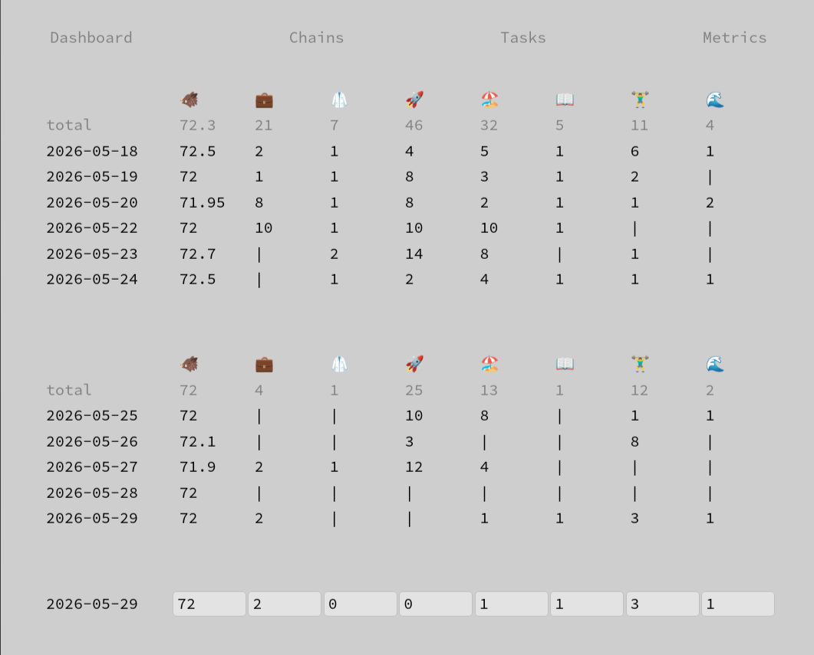

# habits [](https://github.com/ksevelyar/habits-vue/actions/workflows/ci.yml)



## Run

```
nix develop
npm run dev
```

## Documentation
* [Charts](doc/charts.md)
* [Sessions](doc/sessions.md)
* [Telegram notifications](doc/telegram-notifications.md)
